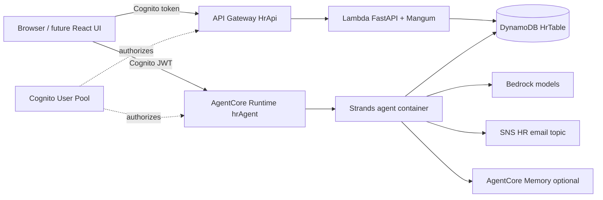
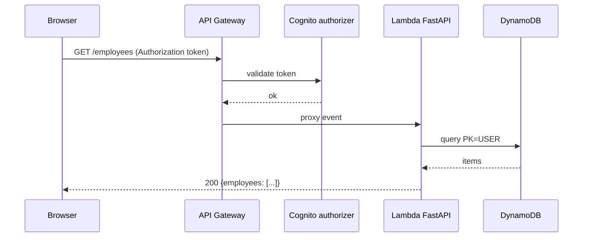
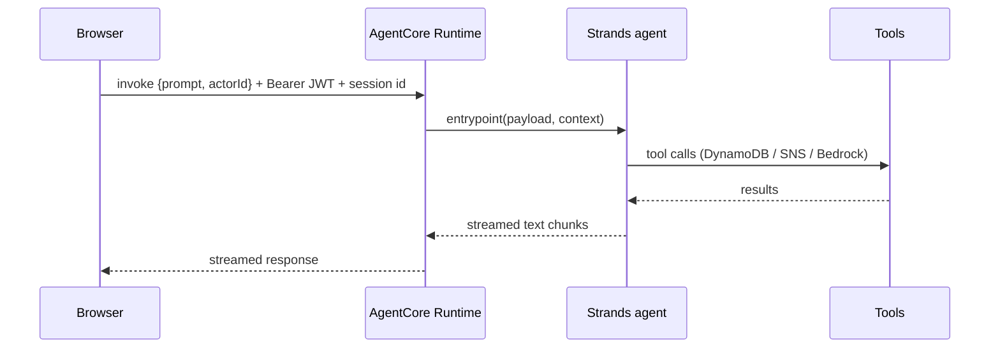

# Architecture

## Architecture Analysis

### System Overview
Serverless AWS system defined with Python CDK. A FastAPI app on Lambda behind API Gateway serves employee CRUD, and a Strands-based agent runs on Bedrock AgentCore Runtime. Both share one DynamoDB table and one Cognito user pool.

### Architectural Style
Serverless, two entry points over a shared data store (evidence: backend_stack.py, agent_runtime_stack.py).

### Component Relationships

Text fallback: the user calls API Gateway (Cognito authorizer) which invokes the Lambda, and calls AgentCore Runtime (Cognito JWT) which runs the agent; both read and write DynamoDB; the agent also uses Bedrock, SNS and optional memory.

### Data Flow
- REST: request -> API Gateway -> Cognito authorizer -> Lambda -> DynamoDB.
- Agent: prompt -> AgentCore -> agent loop -> tools -> DynamoDB/SNS/Bedrock -> streamed text back.

### Key Design Decisions
- Single-table DynamoDB: employees `PK=USER, SK=<employeeId>`; leave `PK=<employeeId>, SK=<startDate>`; GSI1 `USER_BY_DATE` by start date.
- Build artifacts (Lambda layer ARN, agent image URI) pass through SSM parameters, resolved at synth.
- One Cognito pool and client authorize both API Gateway and AgentCore.

### Improvement Opportunities
- Add the missing leave controller; align employee item shape (GSI keys) between REST and agent.
- Restrict CORS, pin account/region, stop hard-coding the SNS ARN.

## Interaction Diagrams

### List employees via REST

Text fallback: the browser sends a token; the authorizer validates it; Lambda queries PK=USER and returns `{employees: [...]}`.

### Chat with hrAgent

Text fallback: the browser invokes the runtime with a prompt; the agent calls tools and streams text chunks back.
